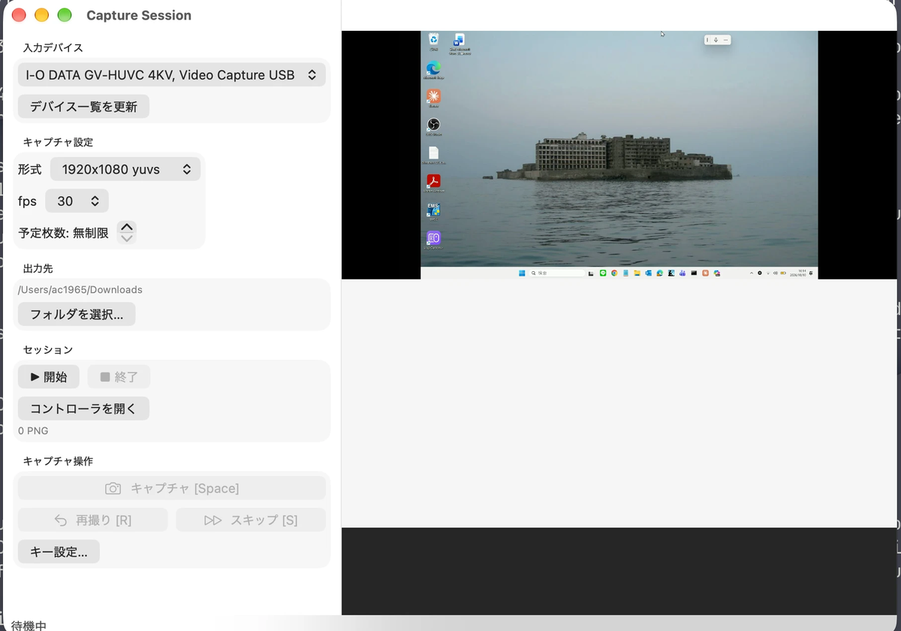
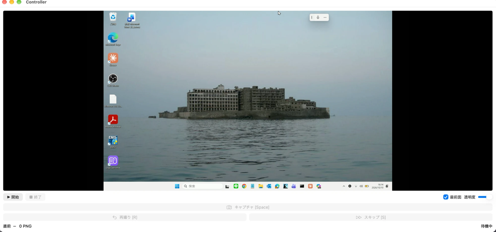

# CaptureSession

HDMI キャプチャデバイスからスナップショットを順番に取得する macOS アプリ（Swift / SwiftUI / AVFoundation）。
セッション単位で PNG を連番管理する。設計は AGENTS.md に記載の設計案に従う。

> Python/tkinter 版から移行した。QuickTime連携は廃止した。





## 動作環境

| 要件 | 内容 |
|---|---|
| macOS | 13 以降（暫定。下限は未決定） |
| ビルド | Xcode 付属の Swift ツールチェーン（Swift Package） |
| ffmpeg | 不要 |

## 実機での稼働情報

2026-10-10 に、次の環境で動作を確認した。

| 項目 | 内容 |
|---|---|
| Mac | MacBook Pro（Mac16,1、Apple M4） |
| macOS | 27.0.1 |
| ビルド | Xcode 27.0 / Swift 6.4（Swift 5 言語モード） |
| キャプチャ機器 | I-O DATA GV-HUVC 4KV（USB） |
| 機器の検出 | `AVCaptureDevice.DiscoverySession`（`.external`）で検出 |
| 機器が返す形式 | 640x480 / 720x480 / 720x576 / 1280x720 / 1600x1200 / 1920x1080（いずれも yuvs・420v）、2560x1440 と 3840x2160（420v のみ） |
| 機器が返す fps | 30.00003 と 60.00024（ちょうど 30 や 60 ではない） |

確認できたこと:

- 機器の検出、ライブプレビュー、キャプチャ、再撮り、スキップ、コントローラ小窓、キー操作、セッション終了。
- `1920x1080 yuvs` と `720x576 420v` で、PNG の保存まで確認。
- アプリ起動中に、別プロセスの ffmpeg が同じ機器から1フレーム取得できた。
- PNG の色味は、ffmpeg 版と見比べて問題なし（画素値の数値比較は未実施）。

実装上の注意:

- fps は、機器が返した値（30.00003 など）をそのまま設定する。30 などの丸めた値を設定すると、AVFoundation が例外を投げる。例外は `CaptureObjC` で捕まえ、落とさずに警告として表示する。

未確認:

- macOS 13 / 14 での動作（`.externalUnknown` の経路を含む）。実機は macOS 27.0.1 のみ。
- Intel Mac での動作。
- `3840x2160` と `2560x1440` でのキャプチャ保存。
- 他のキャプチャ機器。
- QuickTime 収録中の同時取得（QuickTime 連携は廃止した）。
- Developer ID 署名と公証（無料の Developer Program のため行わない）。

## ビルドと起動

```zsh
make test       # コア部分のテスト
make run        # ビルドして起動（dist/CaptureSession.app、ad-hoc署名）
make install    # /Applications に置く
```

`make build` は `zsh scripts/build_app.sh`（xcodebuild）を呼ぶ。起動だけなら `open dist/CaptureSession.app`。

Xcode で `CaptureSession.xcodeproj` を開いて、実行・デバッグもできる。

署名は ad-hoc で、Developer ID署名と公証は行わない（無料のDeveloper Programのため）。他のMacへ渡す場合は、受け取った側で初回だけ「右クリック → 開く」か、`xattr -cr CaptureSession.app` を実行する。

カメラ権限は初回起動時に許可ダイアログが出る。出ない場合は次を開いて許可する。

```zsh
open 'x-apple.systempreferences:com.apple.preference.security?Privacy_Camera'
```

## 使い方

1. 起動するとデバイス一覧を自動取得する（「デバイス一覧を更新」で再取得）
2. 形式（解像度・ピクセル形式）、fps、予定枚数、出力先を設定する。形式と fps は選んだ機器が実際に出せる組み合わせだけが並ぶ
3. 「▶ 開始」でセッションを始め、キーまたはボタンで操作する

| 操作 | 既定のキー | 内容 |
|---|---|---|
| キャプチャ | `Space` | リクエスト後の最初のフレームを PNG 保存 |
| 再撮り | `r` | 直前のキャプチャを削除（末尾がキャプチャのときだけ可能） |
| スキップ | `s` | 連番を1つ使い、`NNNN_SKIPPED.txt` を作る |

キーは「キー設定…」で変更できる（重複・空欄は不可）。「コントローラを開く」で、最前面固定・透明度（0.2〜1.0）つきの小窓を使える。

## 出力

```
~/capture_session/
└── session_20260101_120000/
    ├── capture/
    │   ├── 0001_20260101_120003.png
    │   ├── 0002_SKIPPED.txt
    │   └── ...
    └── log/
        └── capture.log     # 日時 [INFO /WARN /ERROR]  内容
```

連番は「末尾の連番 + 1」。PNG とスキップで連番を共有する。

## 構成

```
Sources/CaptureCore/      # AVFoundation・UIに依存しない部分（Swift Package）
  SessionState.swift      #   entries（キャプチャ/スキップ）だけで連番・再撮りを管理
  SessionStore.swift      #   画面が呼ぶ唯一の入口
  SessionWriter.swift     #   フォルダ・PNG・ログの出力
  Settings.swift          #   キー設定などの保存（UserDefaults）
Sources/CaptureObjC/      # AVFoundation の NSException を Swift のエラーに変換
Tests/CaptureCoreTests/   # 状態管理（スキップ直後の再撮りを含む）などのテスト
App/                      # アプリ本体（Xcodeプロジェクト）
  CaptureService.swift    #   AVCaptureSession / AVCaptureVideoDataOutput
  DeviceAccess.swift      #   カメラ権限、デバイス・フォーマット列挙
  AppModel.swift, Views.swift, CaptureSessionApp.swift
  Info.plist, CaptureSession.entitlements
CaptureSession.xcodeproj
scripts/build_app.sh      # xcodebuild でビルドして dist/ に置く
```
